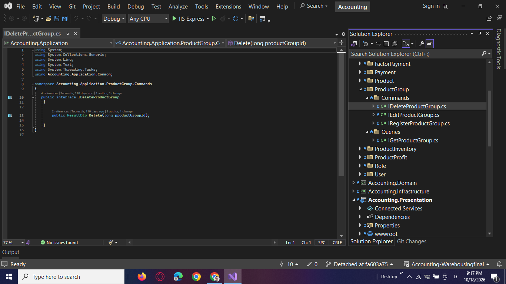
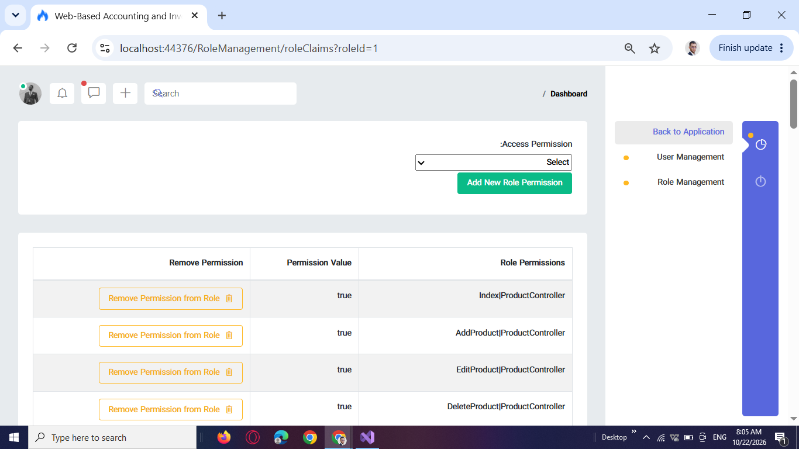
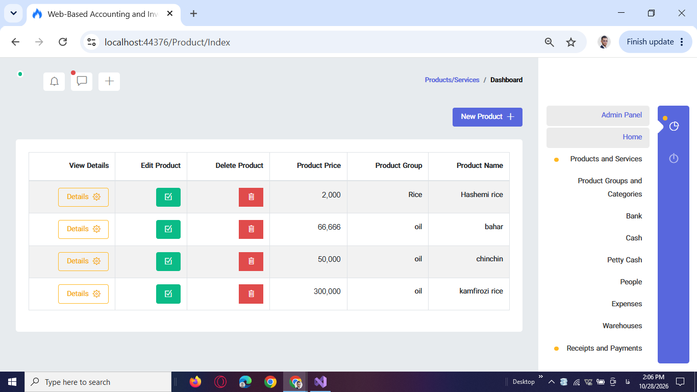
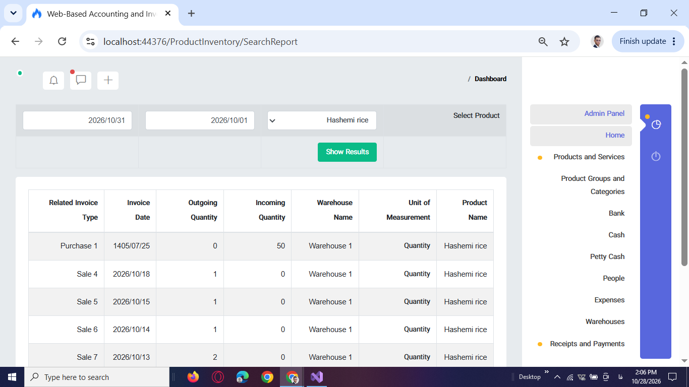
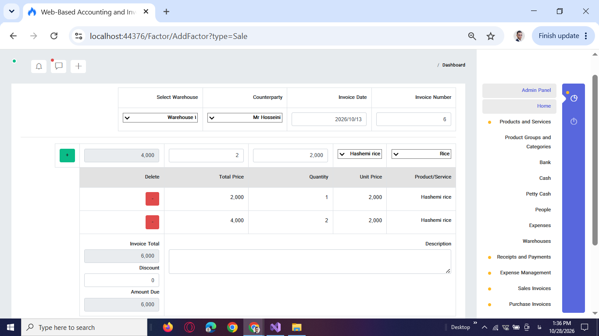
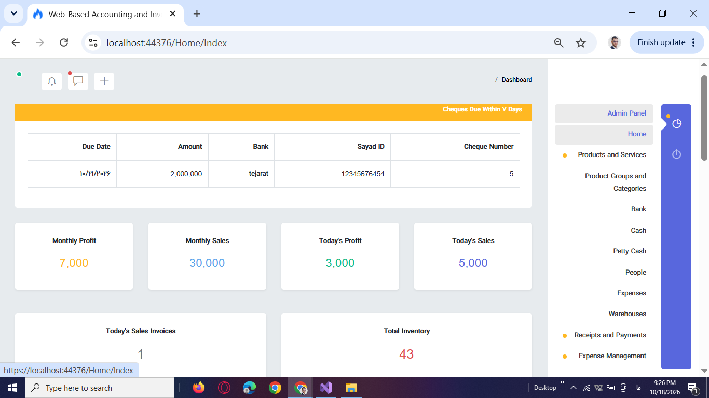
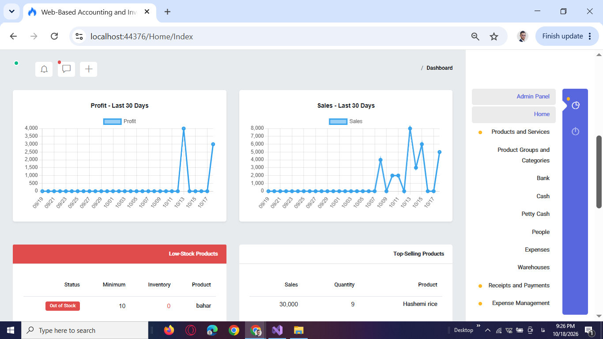

# Accounting & Inventory Management System

An integrated business management application built with **C#, ASP.NET Core, Entity Framework Core, and SQL Server** to support accounting operations, sales and purchase invoices, payments, cheque management, inventory tracking, and financial reporting.

The system brings essential business operations together in one application, helping businesses organize financial records, manage products and stock movements, track outstanding cheques, and monitor financial performance through reports and dashboard analytics.

This project demonstrates my experience developing business-oriented backend applications using **Clean Architecture, CQRS, Entity Framework Core, and ASP.NET Core Identity**.

## Business Problems & Solutions

Businesses often manage financial transactions, inventory, invoices, and reporting across separate workflows. This can make it harder to maintain organized records, track stock movements, monitor payments, and understand business performance.

This application addresses these challenges by providing a centralized system for managing core accounting and inventory operations, with reporting features that help users review financial activity and inventory status.

## Key Features

### 1. Accounting & Financial Documents

- Manage accounts and accounting documents.
- Review account-related financial activity.
- Generate accounting reports using account and date filters.
- Search and review financial records through dedicated reporting pages.

**Business value:** Keeps accounting records organized and makes financial activity easier to review.

### 2. Sales & Purchase Invoices

- Create and manage sales and purchase invoices.
- View invoice details and filter invoice lists by type and date.
- Access invoice-related reports.
- Print invoices using FastReport.
- Support the creation of related receipt or payment records when requested during invoice processing.

**Business value:** Organizes sales and purchasing records and supports related accounting workflows.

### 3. Payments, Receipts & Expenses

- Manage payment and receipt records.
- Record expense-related payments.
- View transaction details and manage financial records.
- Filter payment and receipt reports by relevant criteria, including dates and accounts.

**Business value:** Provides a structured way to review incoming and outgoing financial transactions.

### 4. Cheque Management

- Register cheques and manage cheque information.
- Review cheque statuses, including registered, paid, and returned cheques.
- Identify overdue and upcoming cheques.
- Search cheque records and filter information by issue date and due date.

**Business value:** Helps users monitor cheque obligations and review important payment dates.

### 5. Product & Inventory Management

- Manage products and product groups.
- Review product information, including names and prices.
- Access product inventory and warehouse inventory reports.
- Review incoming and outgoing stock movements.
- Search inventory activity using report filters.

**Business value:** Makes product information and inventory movements easier to track and review.

### 6. Profit & Financial Reporting

- Generate profit reports for business operations.
- Review reports by product, invoice, and date.
- Filter financial results to examine specific transactions and reporting periods.

**Business value:** Helps users examine financial results and understand profitability across products and transactions.

### 7. Dashboard & Business Analytics

- Review key financial and operational indicators.
- Monitor sales and profit summaries.
- View upcoming cheques due within the next seven days.
- Explore sales and profit trends through dashboard charts.
- Review top-selling products and low-inventory alerts.

**Business value:** Brings important business indicators into one place, helping users monitor activity and identify areas that may require attention.

### 8. User, Role & Permission Management

- Manage user accounts and activation status.
- Create and manage application roles.
- Assign users to roles.
- Configure role-associated claims and permissions.
- Use ASP.NET Core Identity for user and role management.

**Business value:** Supports structured user administration and role-based access management.

## Technical Stack

| Technology | Purpose |
|---|---|
| C# | Application logic and backend development |
| ASP.NET Core | Web application and backend functionality |
| Entity Framework Core | Data access and entity relationships |
| SQL Server | Relational data storage |
| ASP.NET Core Identity | User, role, and claims management |
| Clean Architecture | Separation of application responsibilities |
| CQRS | Organizing application operations into commands and queries |
| Docker | Containerization tooling |
| IIS | Application hosting and deployment |
| FastReport | Invoice printing |

## Architecture & Design

The solution is organized into four main projects:

- **Domain:** Core business entities and domain concepts.
- **Application:** Application operations organized around commands and queries.
- **Infrastructure:** Infrastructure concerns, including data access.
- **Presentation:** The application interface and presentation logic.

The project uses **Clean Architecture** to separate responsibilities and **CQRS** to organize commands and queries.

This structure provides a clearer organization for business logic, data access, and application workflows as the system evolves.

## Project Screenshots

### 1. Clean Architecture Solution

**Problem:** As a business application grows, mixing business logic, data access, and presentation responsibilities can make maintenance more difficult.

**Solution:** The solution separates the application into Domain, Application, Infrastructure, and Presentation projects, with commands and queries organized in the Application layer.

**Business value:** Provides a clearer structure for maintaining and extending the application.

### 2. Role & Permission Management

**Problem:** Different users need different levels of access to business operations.

**Solution:** The application uses ASP.NET Core Identity to manage users, roles, and role-associated claims.

**Business value:** Supports organized user administration and permission configuration.

### 3. Product Management

**Problem:** Product information can become difficult to maintain when records are managed inconsistently.

**Solution:** The product management interface provides a centralized view of product records and related information.

**Business value:** Makes product information easier to review and manage.

### 4. Inventory Movement Report

**Problem:** Reviewing stock changes can be difficult without a clear record of incoming and outgoing inventory movements.

**Solution:** The report presents inventory activity with related information such as quantities, invoices, dates, and warehouses.

**Business value:** Helps users review stock movements and investigate inventory activity.

### 5. Sales Invoice

**Problem:** Sales operations require organized invoice records that can be reviewed and maintained.

**Solution:** The invoice interface supports sales invoice creation, management, and access to invoice details.

**Business value:** Keeps sales documentation organized and accessible for related business workflows.

### 6. Financial Overview

**Problem:** Reviewing financial and operational indicators separately can make it harder to understand the overall business situation.

**Solution:** The dashboard brings key financial summaries and upcoming cheque information into one view.

**Business value:** Helps users monitor important indicators without navigating through multiple reports.

### 7. Sales & Inventory Analytics

**Problem:** Transaction records alone do not always make sales trends or inventory concerns easy to identify.

**Solution:** Dashboard analytics include sales and profit charts, top-selling products, and low-inventory alerts.

**Business value:** Supports business monitoring and helps identify products that may require replenishment.

## My Role

I developed the application's backend and business functionality, working with:

- Application architecture and organization.
- Data access and entity relationships.
- Accounting documents and financial workflows.
- Sales and purchase invoice management.
- Payments, receipts, and cheque management.
- Product and inventory reporting.
- Dashboard and profit reporting.
- User, role, and permission management.

The application was deployed on IIS for a transportation company affiliated with NGHSCO.

## Project Showcase

This repository presents an overview of the project, its architecture, key business features, and selected application screenshots.

The source code is not included in this public showcase.

## Contact

- **GitHub:** [saeedrezasedaghat76-cloud](https://github.com/saeedrezasedaghat76-cloud)
- **LinkedIn:** [Add your LinkedIn profile URL]
- **Email:** [Add your professional email address]
